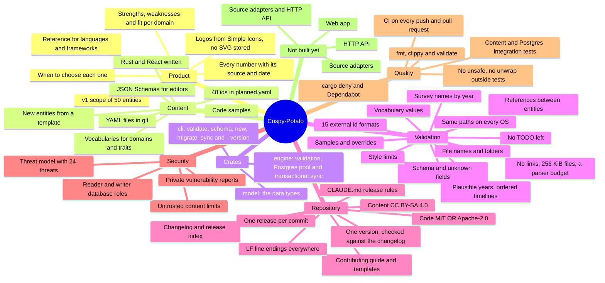
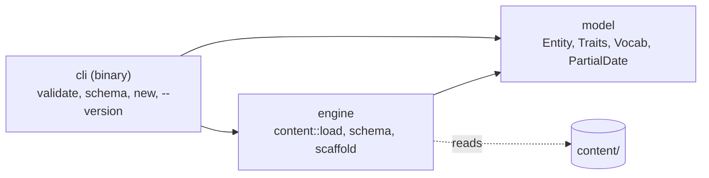

# Crispy-Potato: Mindmap

> **Audience:** contributors, reviewers and whoever implements the next release.
> **Companions:** [architecture.md](architecture.md) says how the system is meant to work, [data-model.md](data-model.md) what each content field means, the [release index](RELEASES_0.1.md) what ships when, and the [changelog](../CHANGELOG.md) what each release changed.
> **Scope:** the repository at `V0.1.24` (2026-10-17). Postgres development environment, curated storage, migrations, content tooling and validation are built. See the release notes below for additions.

---

## The mindmap

---

## 1. What it is

An open-source reference for programming languages, frameworks and runtimes: what each one is good at, where it falls short, how it is trending and how it compares to the alternatives. Hand-written judgement lives in YAML files reviewed through pull requests; numbers (stars, downloads, survey results, releases) will be collected by the engine and always shown with their source and date. The first public version, V0.2.0, covers 18 languages, 27 frameworks in three ecosystems (web frontend, web backend, mobile) and 5 runtimes.

## 2. Content

| What | Where | State |
|---|---|---|
| Languages | `content/languages/` | `rust.yaml` |
| Frameworks | `content/frameworks/` | `react.yaml` |
| Runtimes | `content/runtimes/` | none yet |
| Planned ids | `content/planned.yaml` | the 48 other v1 entities, so files can refer to them before they exist |
| Vocabularies | `content/vocab/domains.yaml`, `content/vocab/traits.yaml` | 13 domains; the allowed values of every trait, each with a label and a description |
| Code samples | `content/samples/<id>/` | `rust/hello.rs`, `react/counter.jsx` |
| New entities | `cargo new-entity <kind> <id>` | since V0.1.16: a template with every field, comments, the vocabulary values and `TODO` placeholders; the id comes off `planned.yaml` |
| Editor schemas | `schemas/` | since V0.1.12: `language`, `framework` and `runtime` JSON Schemas generated by `cargo schema`; each entity file's first line points at its schema |

An entity file holds: `id`, `kind`, `name`, `aliases`, `tagline`, `summary`, `links`, external `ids`, kind-specific `traits`, `domains` (fit per domain), `strengths`, `weaknesses`, `choose_when` (since V0.1.13: 2–4 statements completing "Choose <name> when …"), `relations`, `timeline`, `learning`, `notable_users`, `samples` and `overrides` of collected facts. The fields are described in [data-model.md](data-model.md).

## 3. Crates

| Crate | Holds |
|---|---|
| `model` | `Entity<T>` with `LanguageTraits`, `FrameworkTraits` and `RuntimeTraits`; links, external ids (`ExternalIds::iter`, and `SurveyName` with `for_year` since V0.1.14), domain fit, points, relations, milestones, learning, notable users, overrides; the vocabularies and `Planned`; `PartialDate` (a year, a month or a day) and `current_year()` |
| `engine` | `content::load`: walks `content/` refusing links and oversized files, scans each YAML file against the parser budget, parses it with unknown fields refused, runs the checks in `content/check.rs` and returns either the content or every problem found as `Diagnostic { file, message }` |
| `cli` | `cli validate [--content <dir>]`, run as `cargo validate`; `cli schema [--content <dir>] [--out <dir>] [--check]`, run as `cargo schema`; `cli new <kind> <id> [--content <dir>]`, run as `cargo new-entity` (since V0.1.16; the three aliases are in `.cargo/config.toml`); `cli --version` |

**New entities** (since V0.1.16): `engine::scaffold::new_entity` refuses an invalid id (`content::id_problem`), an existing file and an id planned as another kind, writes the template from `scaffold::template` and takes the id off `planned.yaml` line by line, keeping its comments.

**Schemas** (since V0.1.12): `engine::schema` generates a draft-07 JSON Schema per kind from the model types (which derive `JsonSchema`), fixes `kind` to the folder's kind and turns each vocabulary into an enum with descriptions; `content::load_vocab` reads only the vocabularies for it. `cargo schema --check` fails when the committed files are stale.

Dependencies: `serde`, `serde-saphyr` (YAML), `url`, `indexmap`, `clap`, `schemars` and `serde_json` (since V0.1.12); `tempfile` in tests.

## 4. Validation rules

`cargo validate` reports every problem at once, each as `file: field: message`. Since V0.1.9 the file, and any path inside a message, is relative to the content folder with forward slashes on every OS: `languages/rust.yaml`.

- **Schema:** required fields, no unknown fields, real dates, http or https URLs.
- **Dates** (since V0.1.11): years from 1940 to next year, in timelines and overridden inceptions; timeline milestones in date order.
- **Files:** the file name matches the `id`, the `kind` matches the folder, ids are unique slugs without `vs` as a word (since V0.1.11, for compare URLs); extensions are matched without regard to case, so `.yml` is refused and `Rust.YAML` is read and asked to use lowercase (since V0.1.9).
- **Vocabularies:** every trait, domain and ecosystem value is listed in `content/vocab/`.
- **Survey names** (since V0.1.14): `so_survey` is one name or a map of survey years (2011 to this year) to names, each applying until the next year listed.
- **External ids:** at least one to collect data with (`ExternalIds::has_source`), and since V0.1.11 each checked against its source's format (`content/check/ids.rs`): Wikidata, GitHub (no `.`, `..` or `.git` names), npm, PyPI, crates.io, NuGet, Packagist, RubyGems, pub.dev, Hex, Maven, Stack Overflow tags, the survey name, endoflife.date and, since V0.1.15, the Simple Icons slug of the logo (which doesn't count as an id to collect data with).
- **References:** relations and `traits.languages` point to an entity with a file or a planned one; alternatives share a kind, `runs_on` points to a runtime, nothing refers to itself; a file that fails to parse still counts as known.
- **Style:** 2–6 strengths and weaknesses, 2–4 `choose_when` statements of at most 140 characters (since V0.1.13), taglines of at most 100 characters, a note for `possible` and `poor` fits, no value listed twice, unique aliases.
- **Samples and overrides:** samples exist under `content/samples/`; every override has a reason.
- **Planned ids:** valid slugs without `vs` as a word, listed once, and never also a file.
- **Placeholders** (since V0.1.16): no value may contain `TODO`. Each one is reported by field (`content/placeholders.rs`), and nothing else is reported for that file until they are gone, so a new file fails only on them.
- **Limits on untrusted content** (since V0.1.10): nothing under `content/` may be a symbolic link or a junction, and nothing is read through one; no file may exceed 256 KiB (`MAX_FILE_BYTES`, also enforced while reading); each YAML file is scanned before it is deserialized against a budget of one document, 16 levels, 16 anchors, 64 aliases, 50,000 values and 1 MiB of text, and alias expansion is capped while deserializing.

## 5. Repository and process

- **One release, one commit**, titled `Update V0.1.N` with one bullet per change. The rules are in the [release index](RELEASES_0.1.md#how-each-release-is-made) and, since V0.1.2, in [CLAUDE.md](../CLAUDE.md).
- **Each release** adds a [changelog](../CHANGELOG.md) entry, sets its row in the release index to ✅, updates this mindmap and bumps the version.
- **One version** (since V0.1.7): `workspace.package.version` in the root `Cargo.toml` (0.1.24 now) is inherited by every crate and printed by `cli --version`; `crates/cli/tests/version.rs` fails when the newest changelog entry names another version or a crate sets its own.
- **Decisions D1–D9** in the release index are agreed: licenses, the web framework and tooling, the hosting shape, the secrets the owner provides, what the implementer may run, the tag name, the survey years and the project name.
- **Licenses** (since V0.1.3): code and documentation are MIT OR Apache-2.0 (`LICENSE-MIT`, `LICENSE-APACHE`, and `license` in the workspace manifest, inherited by every crate); everything in `content/` is CC BY-SA 4.0 (`content/LICENSE`); collected data keeps its source's license. The README's License section says the same.
- **Contributing** (since V0.1.19): [CONTRIBUTING.md](../CONTRIBUTING.md) covers adding and editing entities, the sourcing rules (a source for anything disputable, preferred sources, no collected numbers, neutral tone, own words, no unreviewed AI text), the fit-rating rubric, the writing style and the review checklist. `.github/pull_request_template.md` carries the checklist; `.github/ISSUE_TEMPLATE/` has the *Request an entity* and *Report a data problem* forms (the latter's `entity` and `page` fields can be prefilled from the URL) and a link to private security reporting.
- **Line endings** (since V0.1.2): `.gitattributes` stores every text file with LF and marks binary types; `.editorconfig` sets UTF-8, LF, a final newline and the indent size for editors.

## 6. Security

- **[The threat model](security/threat-model.md)** (since V0.1.8) names five assets (data integrity, availability, secrets, visitors' browsers, the code that ships) and five trust boundaries (contributor pull requests, external sources, the public API and website, the operator, third-party code). Each of its 24 threats has a mitigation, the release that delivers it and a status; every 🔒 row of the release index maps to at least one threat. Shipped so far: http-only URLs and sample paths kept inside `samples/` (V0.1.1), CI that untrusted pull requests cannot use to reach secrets (V0.1.4), the cargo deny and pinned-action checks (V0.1.5), the limits on loading untrusted content (V0.1.10), and id formats that can't break URLs or paths (V0.1.11).
- **[SECURITY.md](../SECURITY.md)** (since V0.1.8): vulnerabilities are reported privately through GitHub's private vulnerability reporting, which the owner turns on in the repository settings.

## 7. Quality

| Check | Command | State |
|---|---|---|
| Format | `cargo fmt --check` | passes |
| Lints | `cargo clippy --all-targets -- -D warnings` | passes, with the workspace lints (since V0.1.6) |
| Tests | `cargo test` | 52 pass, including migration, observation upsert and transactional sync tests; requires the local Postgres owner URL |
| Schemas | `cargo schema --check` | up to date (since V0.1.12) |
| Content | `cargo validate` | passes: 1 language, 1 framework, 0 runtimes, 48 planned |
| Dependencies | `cargo deny check` | passes: advisories, bans, licenses and sources (since V0.1.5) |
| CI | `.github/workflows/ci.yml` | since V0.1.4, on pushes to `main` and pull requests: format, lints, validate, schemas, tests, and cargo deny; not yet run on GitHub |

**CI** (since V0.1.4) runs one job on `ubuntu-latest`: format, lints, validate, the schema check (since V0.1.12), then tests. Validation comes before the tests so a broken content file fails at that step. Content pull requests are untrusted: the workflow runs on `pull_request` only, never `pull_request_target`, with a read-only token that is not kept in the checkout, and third-party actions are pinned by commit SHA. A second job (since V0.1.5) runs `cargo deny check`.

**Lints and formatting** (since V0.1.6): every crate inherits the workspace lints in `Cargo.toml`: `unsafe_code` forbidden, `unwrap_used` and `expect_used` warned outside tests (`clippy.toml` allows them in tests, and the engine's integration-test file allows them for its helpers), `dbg_macro` and `todo` denied. `rustfmt.toml` sets the 2024 style edition and LF line endings.

**Supply chain** (since V0.1.5):
- `deny.toml`: RustSec advisories fail the check (unmaintained crates only when the workspace depends on them directly); licenses must be on a permissive allow-list that fits D1, and the workspace's own crates are checked too; crates.io is the only source; no `*` versions; duplicate versions are warned.
- `rust-toolchain.toml` pins the stable channel with rustfmt and clippy.
- Dependabot (`.github/dependabot.yml`) opens weekly pull requests for Cargo and GitHub Actions, for releases at least a week old.

## 8. Not built yet

- **Development environment is built** (V0.1.18): digest-pinned Postgres 17 in `compose.yaml`, `.env.example` and `docs/DEVELOPMENT.md`.
- **data collection** (tracks D and F), **derived data** (track G), **the HTTP API** (track H) and **the web app** (tracks I to N).
- **The other 48 entities** (track E).

### V0.1.18 — A reproducible local Postgres environment.

**Development environment.** Digest-pinned Postgres 17, a localhost port, persistent volume, health check, ignored local settings and a development guide with the settings table

Checks: Docker Compose startup and psql connection, cargo fmt, clippy, test (45 tests), validate and schema --check pass; GitHub CI was not run because nothing is pushed

### V0.1.19 — Postgres storage and explicit migrations.

**Database.** sqlx 0.8 and Tokio 1, a five-connection pool with acquire and statement timeouts, cli migrate, seven curated-data tables and isolated database tests with Postgres in CI

Checks: cargo fmt, clippy, test (46 tests), validate, schema --check and cargo deny pass; migrations run twice locally; GitHub CI awaits a push

### V0.1.20 — Storage for collected data and provenance.

**Collected data.** Migration 0002 adds sources, observations, quarantine, releases, facts, ingestion runs and HTTP validators; observations upsert by entity, metric, period, date and source; the data model documents all fourteen tables

Checks: cargo fmt, clippy, test (47 tests), validate and schema --check pass, including a real Postgres observation upsert test; GitHub CI awaits a push

### V0.1.21 — Validated content sync in one transaction.

**Sync.** cli sync writes a stable validated snapshot, derives reverse relations, imports samples and vocabularies, hashes all content with sha2 0.10, skips unchanged runs and retires removed entities without deleting collected history

Checks: cargo fmt, clippy, test (48 tests), validate, schema --check and cargo deny pass; sync repeatability, invalid-input rollback and retirement are tested in Postgres; GitHub CI awaits a push

### V0.1.22 — SQL checked at compile time, with offline builds.

**Checked queries.** Application SQL uses sqlx macros, .sqlx metadata is committed, SQLX_OFFLINE defaults to true and CI checks metadata against migrated Postgres

Checks: cargo fmt, clippy, test (48 tests), validate, schema --check, sqlx prepare --check and offline cargo build pass; a deliberately misspelled column fails compilation; GitHub CI awaits a push

### V0.1.23 — Separate reader, writer and migration privileges.

**Database roles.** Idempotent owner-run roles.sql creates cp_reader and cp_writer, grants only required table and sequence permissions, denies DDL and migration-history edits, and introduces API_DATABASE_URL without a writer fallback

Checks: cargo fmt, clippy, test (49 tests), validate and schema --check pass; Postgres role tests deny reader writes and writer DDL; GitHub CI awaits a push

### V0.1.24 — A bounded retrying HTTP client for sources.

**HTTP.** reqwest 0.12 with rustls, gzip and brotli, connect and body deadlines, a 20 MiB decoded cap, identifying User-Agent and three attempts with jitter and Retry-After; httpdate 1 and wiremock 0.6 added

Checks: cargo fmt, clippy, test (52 tests), validate, schema --check and cargo deny pass; wiremock covers 503 recovery, attempt limits, Retry-After, oversized bodies and timeouts; no live source adapter is built yet
