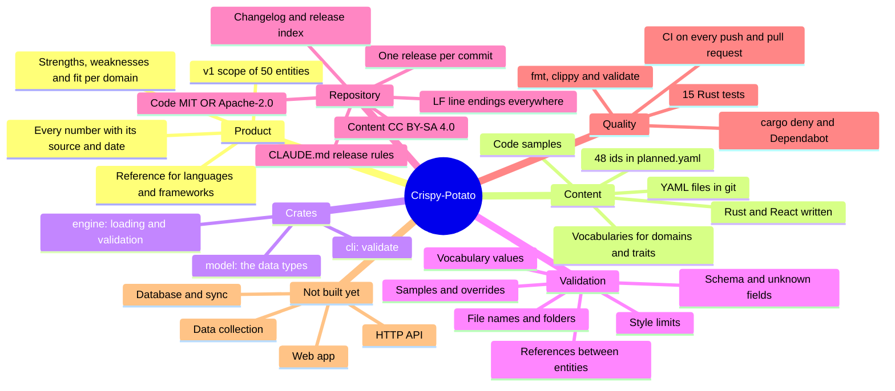
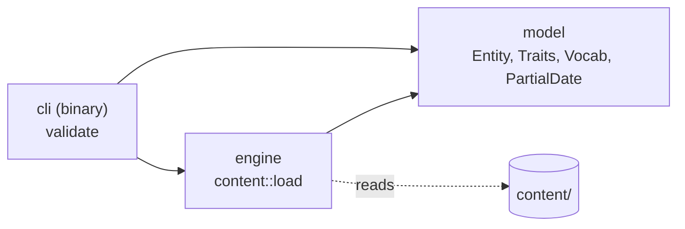

# Crispy-Potato: Mindmap

> **Audience:** contributors, reviewers and whoever implements the next release.
> **Companions:** [architecture.md](architecture.md) says how the system is meant to work, [data-model.md](data-model.md) what each content field means, the [release index](RELEASES_0.1.md) what ships when, and the [changelog](../CHANGELOG.md) what each release changed.
> **Scope:** the repository at `V0.1.5` (2026-10-17). V0.1.5 adds the supply-chain checks (cargo deny, Dependabot, a pinned toolchain); V0.1.4 adds CI on GitHub Actions; V0.1.3 adds the licenses (code MIT OR Apache-2.0, content CC BY-SA 4.0); V0.1.2 adds the changelog, `CLAUDE.md`, this mindmap, `.gitattributes` and `.editorconfig`; V0.1.1 built the model, the validator and the first two entities.

---

## The mindmap

---

## 1. What it is

An open-source reference for programming languages, frameworks and runtimes: what each one is good at, where it falls short, how it is trending and how it compares to the alternatives. Hand-written judgement lives in YAML files reviewed through pull requests; numbers (stars, downloads, survey results, releases) will be collected by the engine and always shown with their source and date. The first public version, V0.2.0, covers 18 languages, 27 frameworks in three ecosystems (web frontend, web backend, mobile) and 5 runtimes.

## 2. Content

| What | Where | State |
|---|---|---|
| Languages | `content/languages/` | `rust.yaml` |
| Frameworks | `content/frameworks/` | `react.yaml` |
| Runtimes | `content/runtimes/` | none yet |
| Planned ids | `content/planned.yaml` | the 48 other v1 entities, so files can refer to them before they exist |
| Vocabularies | `content/vocab/domains.yaml`, `content/vocab/traits.yaml` | 13 domains; the allowed values of every trait, each with a label and a description |
| Code samples | `content/samples/<id>/` | `rust/hello.rs`, `react/counter.jsx` |

An entity file holds: `id`, `kind`, `name`, `aliases`, `tagline`, `summary`, `links`, external `ids`, kind-specific `traits`, `domains` (fit per domain), `strengths`, `weaknesses`, `relations`, `timeline`, `learning`, `notable_users`, `samples` and `overrides` of collected facts. The fields are described in [data-model.md](data-model.md).

## 3. Crates

| Crate | Holds |
|---|---|
| `model` | `Entity<T>` with `LanguageTraits`, `FrameworkTraits` and `RuntimeTraits`; links, external ids, domain fit, points, relations, milestones, learning, notable users, overrides; the vocabularies and `Planned`; `PartialDate` (a year, a month or a day) |
| `engine` | `content::load`: reads `content/`, parses each file with unknown fields refused, runs the checks in `content/check.rs` and returns either the content or every problem found |
| `cli` | `cli validate [--content <dir>]`, run as `cargo validate` (an alias in `.cargo/config.toml`) |

Dependencies: `serde`, `serde-saphyr` (YAML), `url`, `indexmap`, `clap`; `tempfile` in tests.

## 4. Validation rules

`cargo validate` reports every problem at once, each as `file: field: message`.

- **Schema:** required fields, no unknown fields, real dates, http or https URLs.
- **Files:** the file name matches the `id`, the `kind` matches the folder, ids are unique slugs, `.yml` is refused.
- **Vocabularies:** every trait, domain and ecosystem value is listed in `content/vocab/`.
- **External ids:** at least one; Wikidata ids look like `Q575650`; GitHub ids are `owner/repo`.
- **References:** relations and `traits.languages` point to an entity with a file or a planned one; alternatives share a kind, `runs_on` points to a runtime, nothing refers to itself; a file that fails to parse still counts as known.
- **Style:** 2–6 strengths and weaknesses, taglines of at most 100 characters, a note for `possible` and `poor` fits, no value listed twice, unique aliases.
- **Samples and overrides:** samples exist under `content/samples/`; every override has a reason.
- **Planned ids:** valid slugs, listed once, and never also a file.

## 5. Repository and process

- **One release, one commit**, titled `Update V0.1.N` with one bullet per change. The rules are in the [release index](RELEASES_0.1.md#how-each-release-is-made) and, since V0.1.2, in [CLAUDE.md](../CLAUDE.md).
- **Each release** adds a [changelog](../CHANGELOG.md) entry, sets its row in the release index to ✅, updates this mindmap and bumps the crate versions (0.1.5 now).
- **Decisions D1–D9** in the release index are agreed: licenses, the web framework and tooling, the hosting shape, the secrets the owner provides, what the implementer may run, the tag name, the survey years and the project name.
- **Licenses** (since V0.1.3): code and documentation are MIT OR Apache-2.0 (`LICENSE-MIT`, `LICENSE-APACHE`, and `license` in the workspace manifest, inherited by every crate); everything in `content/` is CC BY-SA 4.0 (`content/LICENSE`); collected data keeps its source's license. The README's License section says the same.
- **Line endings** (since V0.1.2): `.gitattributes` stores every text file with LF and marks binary types; `.editorconfig` sets UTF-8, LF, a final newline and the indent size for editors.

## 6. Quality

| Check | Command | State |
|---|---|---|
| Format | `cargo fmt --check` | passes |
| Lints | `cargo clippy --all-targets -- -D warnings` | passes |
| Tests | `cargo test` | 15 pass: 2 for dates in `model`, 13 for content in `engine/tests/content.rs` |
| Content | `cargo validate` | passes: 1 language, 1 framework, 0 runtimes, 48 planned |
| Dependencies | `cargo deny check` | passes: advisories, bans, licenses and sources (since V0.1.5) |
| CI | `.github/workflows/ci.yml` | since V0.1.4, on pushes to `main` and pull requests: format, lints, validate, tests; not yet run on GitHub |

**CI** (since V0.1.4) runs one job on `ubuntu-latest`. Validation comes before the tests so a broken content file fails at that step. Content pull requests are untrusted: the workflow runs on `pull_request` only, never `pull_request_target`, with a read-only token that is not kept in the checkout, and third-party actions are pinned by commit SHA. A second job (since V0.1.5) runs `cargo deny check`.

**Supply chain** (since V0.1.5):
- `deny.toml`: RustSec advisories fail the check (unmaintained crates only when the workspace depends on them directly); licenses must be on a permissive allow-list that fits D1, and the workspace's own crates are checked too; crates.io is the only source; no `*` versions; duplicate versions are warned.
- `rust-toolchain.toml` pins the stable channel with rustfmt and clippy.
- Dependabot (`.github/dependabot.yml`) opens weekly pull requests for Cargo and GitHub Actions, for releases at least a week old.

## 7. Not built yet

- **Workspace lints** (V0.1.6), **one version source** (V0.1.7), **the threat model** (V0.1.8).
- **Database and sync** (track C), **data collection** (tracks D and F), **derived data** (track G), **the HTTP API** (track H) and **the web app** (tracks I to N).
- **The other 48 entities** (track E).
