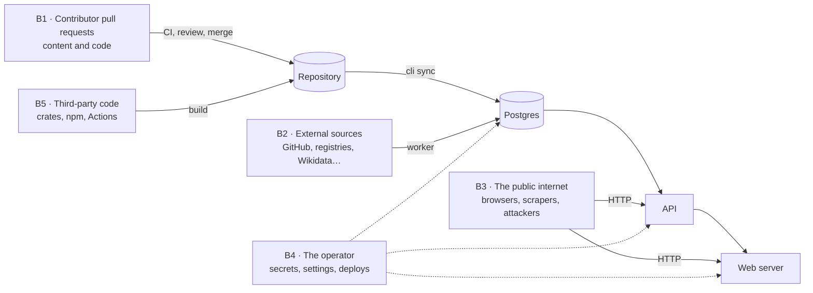

# Threat model

> **Written in:** V0.1.8 (2026-10-17) · **Reviewed in:** V0.1.138 and V0.1.145 (planned)
> **Related:** [SECURITY.md](../../SECURITY.md) · [Release index](../RELEASES_0.1.md) · [Architecture](../architecture.md)

What Crispy-Potato protects, where untrusted input crosses into it, what could go wrong at each crossing, and which release in the [release index](../RELEASES_0.1.md) deals with it. Most of the system is not built yet, so most mitigations are planned (🔜); the status column changes as releases ship. A new threat, or a 🔒 row added to the index, is added here in the same release.

---

## What is protected

| # | Asset | Why it matters |
|---|---|---|
| A1 | **Data integrity** | The site is only useful if what it shows is what it claims to be: curated text that went through review, and collected numbers that really came from the named source on the named date. Tampered, fabricated or silently wrong data is the worst failure, because readers cannot tell. |
| A2 | **Availability** | The API, the website and the worker stay up and answer within the targets in `docs/performance.md`; collection keeps running without getting the project blocked by its sources. |
| A3 | **Secrets** | The GitHub token, the Stack Exchange key, `WEB_API_KEY` and the database credentials. A leaked token can be abused under the project's name and burn its quotas. |
| A4 | **Visitors' browsers** | Nothing the site renders may run script or leak data to another origin. The site has no accounts, so there is no session to steal, but injected script could still deface pages, mislead readers or attack them. |
| A5 | **The code that ships** | The crates, the web app and the CI pipeline that builds them. A compromised dependency or workflow undermines every other asset. |

Out of scope for 0.2.0: accounts and authentication (there are none), anything users write at runtime (the API is read-only), network-level denial of service (left to the CDN or provider picked after 0.2.0, decision D4), and the security of the external sources themselves.

---

## Trust boundaries

| # | Boundary | What crosses it | Trusted? |
|---|---|---|---|
| B1 | **Contributor pull requests** | Content files (YAML, samples) and code changes from anyone with a GitHub account | No. Reviewed by a maintainer before merge; CI runs on them before review. |
| B2 | **External sources** | Responses from GitHub, endoflife.date, Wikidata, the package registries, Stack Exchange, OpenSSF Scorecard and the survey CSV | No. Parsed as hostile input every time. |
| B3 | **The public API and website** | Requests from anyone on the internet | No. Read-only, rate-limited, validated. |
| B4 | **The operator** | Secrets, settings, migrations and deploys | Yes, but mistakes happen: the system limits what a leaked credential or a misconfiguration can do. |
| B5 | **Third-party code** | Rust crates, npm packages and GitHub Actions pulled into the build | Partly. Each is checked for advisories, licenses and sources, and pinned. |

---

## Threats

Status: ✅ mitigated by a shipped release · 🔜 planned. *Release* names the rows that mitigate the threat; a 🔒 mark is a security row.

### B1 · Contributor pull requests

| # | Threat | Asset | Mitigation | Release | Status |
|---|---|---|---|---|---|
| T1 | A content file built to exhaust memory or CPU in CI, sync or the API: an alias bomb, deep nesting, a huge file | A2 | Files over 256 KiB refused; the YAML parser's budget limits depth, anchors and alias expansion | 🔒 V0.1.10 | ✅ |
| T2 | A symlink under `content/` (a sample linking to `/etc/passwd` or a secrets file) that sync stores and the API later serves | A3, A1 | Symlinks and junctions anywhere under `content/` refused, and nothing read through them; sample paths must stay inside `samples/` (V0.1.1) | 🔒 V0.1.10, V0.1.1 | ✅ |
| T3 | A URL in content with a `javascript:` or `data:` scheme that becomes a link on the site | A4 | Validation accepts only http and https (V0.1.1); the web app checks again before rendering a link | V0.1.1, 🔒 V0.1.134 | ✅ validation, 🔜 rendering |
| T4 | A pull request that runs code in CI with write access or secrets (`pull_request_target`, a writable token) | A3, A5 | CI runs on `pull_request` only, with a read-only token not kept in the checkout; actions pinned by SHA | V0.1.4 | ✅ |
| T5 | An id crafted to break URLs or paths: `..` or `x.git` as a GitHub repo, `-vs-` in an entity id, an empty registry id | A1, A2 | Each external id kind checked against its registry's format; `vs` refused as a word in ids | V0.1.11 | ✅ |
| T6 | Fabricated or misleading claims, or collected numbers written into content by hand | A1 | The schema refuses unknown fields, so `stars:` fails (V0.1.1); review and sourcing rules (V0.1.17); link and id checks (V0.1.32, V0.1.33) | V0.1.1, V0.1.17, V0.1.32, V0.1.33 | ✅ schema, 🔜 the rest |

### B2 · External sources

| # | Threat | Asset | Mitigation | Release | Status |
|---|---|---|---|---|---|
| T7 | A hostile or broken response (a huge body, deep nesting, control or right-to-left override characters, NaN or negative counts) that crashes the worker or corrupts stored data | A1, A2 | A 20 MiB response cap (V0.1.24); typed parsing, text length caps with control and bidi characters removed, range-checked numbers, failures scoped to one entity | V0.1.24, 🔒 V0.1.28 | ✅ |
| T8 | Source text stored as HTML and rendered on the site (stored XSS) | A4 | Source text is never stored as HTML and always rendered as text | 🔒 V0.1.28, 🔒 V0.1.134 | Storage ✅; rendering planned |
| T9 | A well-formed but wrong value (a buggy or compromised source) shown as fact | A1 | Plausibility checks quarantine values that fall or jump implausibly (V0.1.29); curated `overrides` replace wrong facts (V0.1.1, applied in V0.1.60) | V0.1.29, V0.1.60 | 🔜 |
| T10 | The project gets blocked by a source for exceeding its limits, and data stops | A2 | Per-host rate limits and concurrency caps, `Retry-After` and `backoff` honored, an identifying User-Agent | V0.1.24, V0.1.26 | 🔜 |

### B3 · The public API and website

| # | Threat | Asset | Mitigation | Release | Status |
|---|---|---|---|---|---|
| T11 | Request floods or expensive queries that exhaust the API, the database or the web server | A2 | Request timeouts, header and URI limits, only safe methods (🔒 V0.1.91); per-client rate limits (🔒 V0.1.92); response caching (V0.1.89, V0.1.90); the web server's own limits (🔒 V0.1.135) | 🔒 V0.1.91, 🔒 V0.1.92, 🔒 V0.1.135, V0.1.89, V0.1.90 | 🔜 |
| T12 | Rate limits evaded with a spoofed `X-Forwarded-For` | A2 | The client address comes from the socket unless `TRUST_PROXY` is set | 🔒 V0.1.92, 🔒 V0.1.135 | 🔜 |
| T13 | SQL injection through query parameters | A1, A3 | SQL only through sqlx bindings (a standing rule); compile-time checked queries (V0.1.22); ids and query values validated before any query (🔒 V0.1.91) | V0.1.22, 🔒 V0.1.91 | 🔜 |
| T14 | Errors that leak internals: SQL, file paths, stack traces | A3, A5 | Every API error is a generic problem body with internals only in logs (V0.1.79); production error pages without stack traces (🔒 V0.1.135) | V0.1.79, 🔒 V0.1.135 | 🔜 |
| T15 | Script injection on the website, through content, source text or a reflected search query | A4 | A strict nonce-based CSP (🔒 V0.1.133); `dangerouslySetInnerHTML` banned except escaped Shiki and JSON-LD output, URLs rechecked (🔒 V0.1.134) | 🔒 V0.1.133, 🔒 V0.1.134 | 🔜 |
| T16 | Clickjacking, MIME sniffing and cross-origin leaks | A4 | `nosniff`, `Cross-Origin-Resource-Policy`, `Referrer-Policy` and CORS limited to configured origins on the API (🔒 V0.1.91); `frame-ancestors 'none'`, HSTS, COOP and a Permissions-Policy on the website (🔒 V0.1.133) | 🔒 V0.1.91, 🔒 V0.1.133 | 🔜 |

### B4 · The operator

| # | Threat | Asset | Mitigation | Release | Status |
|---|---|---|---|---|---|
| T17 | A secret leaks through logs, error bodies, `Debug` output or a logged URL | A3 | Secrets held in `secrecy` types that redact themselves, read from the environment or `*_FILE`, request URLs never logged whole | 🔒 V0.1.31 | ✅ |
| T18 | `WEB_API_KEY` or `API_URL` ends up in the browser bundle, letting anyone skip the rate limits | A2, A3 | The API client runs on the server only, and build checks fail when a server setting appears in client assets | V0.1.100, 🔒 V0.1.135 | 🔜 |
| T19 | A compromised API process writes or drops data | A1 | The API connects as `cp_reader` (SELECT only); sync and the worker as `cp_writer` (no DDL); migrations as the owner | 🔒 V0.1.23 | ✅ |
| T20 | Containers running as root widen a compromise | A1, A3 | Distroless images running as a non-root user | V0.1.137, V0.1.143 | 🔜 |
| T21 | Data is lost to a failed disk or a bad migration | A1, A2 | Scheduled `pg_dump` backups and a restore script tested in CI | V0.1.140 | 🔜 |

### B5 · Third-party code

| # | Threat | Asset | Mitigation | Release | Status |
|---|---|---|---|---|---|
| T22 | A Rust dependency with a known vulnerability, from an unexpected source, or under a license that conflicts with D1 | A5 | `cargo deny check` in CI: RustSec advisories, crates.io only, a license allow-list (🔒 V0.1.5); a daily audit on main and SBOMs (🔒 V0.1.139) | 🔒 V0.1.5, 🔒 V0.1.139 | ✅ CI check, 🔜 daily audit |
| T23 | A malicious npm package: install scripts, or a freshly published compromised version | A5 | pnpm `minimumReleaseAge` of 7 days, install scripts blocked except an allow-list, exact versions, `pnpm audit` and a license check in CI (🔒 V0.1.97); a daily audit and SBOMs (🔒 V0.1.139) | 🔒 V0.1.97, 🔒 V0.1.139 | 🔜 |
| T24 | A GitHub Action whose tag is moved to malicious code | A5, A3 | Actions pinned by commit SHA (V0.1.4); Dependabot proposes updates for releases at least a week old (🔒 V0.1.5) | V0.1.4, 🔒 V0.1.5 | ✅ |

---

## Every 🔒 row and its threats

| Release | What it does | Threats |
|---|---|---|
| V0.1.5 | Supply chain: cargo deny, a pinned toolchain, Dependabot | T22, T24 |
| V0.1.8 | This threat model and `SECURITY.md` | all: it names them, and gives a private route to report new ones |
| V0.1.10 | Limits on untrusted content files | T1, T2 |
| V0.1.23 | Least-privilege database roles | T19 |
| V0.1.28 | Untrusted source responses | T7, T8 |
| V0.1.31 | Secrets | T17 |
| V0.1.91 | HTTP hardening of the API | T11, T13, T16 |
| V0.1.92 | Rate limiting of the API | T11, T12 |
| V0.1.97 | Web supply chain | T23 |
| V0.1.133 | Security headers and CSP on the website | T15, T16 |
| V0.1.134 | Output safety on the website | T3, T8, T15 |
| V0.1.135 | Web server hardening | T11, T12, T14, T18 |
| V0.1.138 | First written security review | all: each threat checked against what was built |
| V0.1.139 | Daily audits and SBOMs | T22, T23 |
| V0.1.145 | Second written security review | all, with the website and the deployment |

## Keeping this current

- A release that mitigates a threat sets its status to ✅ here.
- A release that adds an asset, a boundary or a way in adds the threat here, and a 🔒 row to the index if it needs one.
- The security reviews (V0.1.138, V0.1.145) check every threat against the code and record their findings in `docs/security/`.
